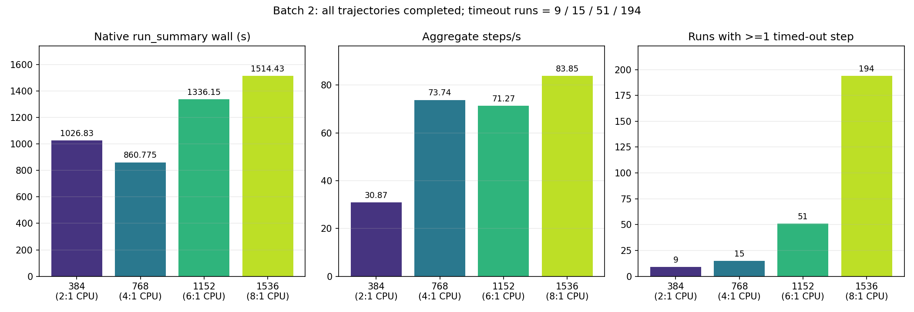
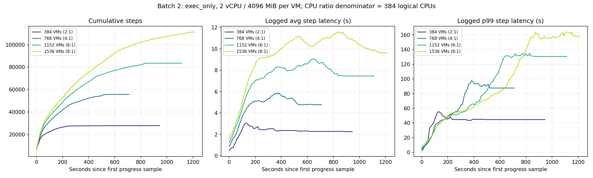
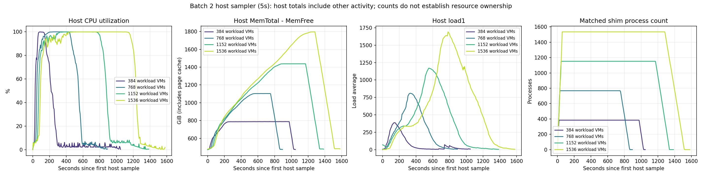

# CubeSandbox SWE 回放结果（2026-10-09–10）

第二批 ARM64 密度测试完成了 384、768、1152、1536 条轨迹回放；含超时步骤的 run 分别为
9、15、51、194。完成轨迹不等于无退化：1536 档有 12.63% 的 run 至少一次触发 300 秒步骤超时。
本页保存成功、受配额限制和中断批次，三类数据分开解释。

数据是历史实验的脱敏发布副本，未在发布时重跑。完整文件位置见[发布说明](../README.md)，
可计算数据见 [summary.csv](summary.csv)、[summary.json](summary.json)，来源及哈希见
[evidence-manifest.json](evidence-manifest.json)。
发布校验结果、派生产物的输入关系及旧错误图哈希见 [publication-info.json](publication-info.json)。

## 1. 工具、环境和计时口径

| 项目 | 固定条件 |
|---|---|
| 负载执行器 | 上游 `JackWeiw/agent_vm_bench` 的原生 `bench-core`；不是 CubeSandbox 自带的 `cube-bench` |
| `.95` 功能验证驱动 | `262a0534cc76d138a38b42bc890c9bdd9b40922d` |
| `.90` 两批密度驱动 | `93f978f7ec27d9bc519dca2efdc809ada09acbaa`；运行副本无 .git，历史验证以核心文件哈希对照来源 |
| SDK | 真实 `cubesandbox==0.7.0`，历史校验排除了 provider Mock |
| 节点 | ARM64 / openEuler 24.03 系；`.90` 记录为 384 个逻辑 CPU、约 2.26 TiB 内存 |
| 平台 | 历史 v0.7.1 测试部署；并非承诺所有运行二进制均为干净的同一发布 commit |
| 镜像/模板 | 55 条 Go/TS/Java 案例；每 VM 2000m CPU、4096Mi 内存，workdir=/testbed |
| 回放 | exec_only、delay_scale=0、action_timeout=300 秒、stop_on_error=false、round_count=1 |
| 原生监控 | 第二批 `monitor.enabled="true"`、`vmm=cubesandbox`、采样间隔 2 秒；第一批缺少有效主机/VM 监控 |
| 额外宿主采样 | 自定义 `host_sampler.py`，间隔 5 秒；是全机视图，不只包含本次负载 |
| 发布工具 | 自定义 Python 3.10.12 提取与校验；Matplotlib 3.10.9 / NumPy 2.2.6 绘制发布图 |

表中的 CPU 配置比例统一为 `N×2/384`。历史配置注释曾写“383 usable cores”，若采用该预算，
应改算 `N×2/383`，不能继续使用精确的 2/4/6/8 倍。原生 `run_summary.overcommit_ratio=1`
是运行槽口径，保留原值，不替换成 CPU 比例。

本页 wall/steps/s 均来自原生 run_summary。exec_only 的 VM 创建发生在 collector 启动前；
wall 从 collector 启动计至导出时读取，不是创建、执行、清理的全流程耗时。
Excel、文本和 JSON 在不同导出时刻读取统计，彼此存在小幅差异时不混用。
进度图以每轮第一条进度记录为零点，宿主图以第一条采样为零点，二者不是统一启动时间轴。

## 2. 第二批：有监控的密度阶梯

| 档位/数据目录 | 配置 CPU 比例 | wall(s) | 总步骤 | steps/s | 完成轨迹 | 含超时 run |
|---|---:|---:|---:|---:|---:|---:|
| [384](runs/batch2-384/) | 2 | 1026.827 | 31701 | 30.873 | 384/384 | 9 |
| [768](runs/batch2-768/) | 4 | 860.775 | 63470 | 73.736 | 768/768 | 15 |
| [1152](runs/batch2-1152/) | 6 | 1336.151 | 95229 | 71.271 | 1152/1152 | 51 |
| [1536](runs/batch2-1536/) | 8 | 1514.433 | 126986 | 83.851 | 1536/1536 | 194 |







SVG 下载：[汇总](batch2/charts/13_ladder_summary_verified.svg)、
[进度与时延](batch2/charts/10_ladder_progress_latency_corrected.svg)、
[宿主资源](batch2/charts/11_ladder_host_corrected.svg)。
各轮目录保留原生 `*_obs.xlsx`、Gantt、`vm_monitor/resource_report.xlsx` 及 CPU、内存、NUMA、
压力、swap 等实际生成的 SVG；例如 [1536 档监控目录](runs/batch2-1536/vm_monitor/)。

四轮导出的步骤没有非超时 slice_failed，导出的 run 没有 create/kill error 标记；
这不能外推为任意负载、任意持续时间均稳定。宿主存在约 100 个平台既有 VM，历史结束记录为 99；
不能把全机 CPU、内存或每个匿名 VM 都归属于本次负载，也不能用固定减 100 的方式消除背景影响。
匹配 shim 进程的计数曲线仅代表采样器匹配结果，不能单独证明实际 RUNNING 数与资源归属。

## 3. 第一批：无有效主机/VM 指标

| 档位/数据目录 | 请求数 | 完成数 | 未完成数 | wall(s) | 步骤 | steps/s | 含超时 run |
|---|---:|---:|---:|---:|---:|---:|---:|
| [384](runs/batch1-384/) | 384 | 384 | 0 | 1087.749 | 31701 | 29.144 | 34 |
| [768](runs/batch1-768/) | 768 | 768 | 0 | 1174.244 | 63470 | 54.052 | 90 |
| [1152 尝试](runs/batch1-1152-attempt/) | 1152 | 768 | 384 | 945.174 | 63470 | 67.152 | 10 |

1152 尝试从第 769 个开始被调度配额拒绝，不能作为达到 1152 密度的数据点。
原生逐轨迹结果只覆盖成功进入回放的实例；其 `create_error_runs=0` 不代表全轮没有创建失败，
必须结合 run_summary 中的 failed=384 判断。保留这一缺口，未补造不存在的失败轨迹记录。

历史对比图：[进度](batch1/charts/01_steps_progress.png)、
[相邻采样吞吐](batch1/charts/02_throughput.png)、[时延](batch1/charts/03_step_latency.png)、
[run 耗时分布](batch1/charts/04_run_elapsed_hist.png)、[step 时延分布](batch1/charts/05_step_exec_hist.png)。
这些图只覆盖第一批 384/768，不包含第一批 1152 尝试。
两批的监控、背景资源和缓存状态不同；超时数改善只是观察，没有单变量实验支持缓存因果结论。

## 4. 功能预检、准入及无效批次

| 记录 | 已验证事实 | 使用边界 |
|---|---|---|
| [.95 工作目录修正前](runs/cube95-cwd-before/) | 118 步，8 条非零 | 留作修正前对照，不是最终通过结果 |
| [.95 /testbed 修正后](runs/cube95-testbed/) | 118 步，6 条原有非零，返回码逐条匹配历史基线，无超时 | 一条 ARM64 功能验证 |
| [.90 第一批预检](runs/batch1-preflight/) / [第二批预检](runs/batch2-preflight/) | 各 118 步、6 条非零、无超时 | 不作为密度性能数据 |
| [900 create-only 统计](batch2/data/admission-900.txt) | 900 ready，create/ready failed 均为 0 | 调整准入后的空闲 VM 创建检查，没有执行 900 条 workload |
| [中断批次](runs/quarantine-interrupted/) | 手工 timeout 中止；summary 写 5143 步，逐轨迹只导出 5142 步，0 条轨迹完成 | 明确无效；不能用其 577.977 steps/s 做性能比较 |

900 准入检查的原始统计区分两层：Sandbox.create 的 P50/P95/P99 为 0.2/0.3/0.4 秒，
包含 ready check 的 Total Startup 为 0.2/0.4/0.4 秒。不能把两套边界合并。

普通命令非零不等于超时或基础设施异常。run 是轨迹×沙箱×轮次；含超时 run 仍可执行到轨迹末尾，
所以“轨迹完成”和“无超时通过”是不同结果。`nonzero_exit_steps` 包含所有非零步骤，可能与 timeout
重叠，不是已排除超时的纯业务失败数。

## 5. 命令、参数和清理来源

以下保留历史原生入口，路径作相对化展示。配置发布为 JSON（与 YAML 解析后的值一致），位于
[第一批配置/进度](batch1/data/) 和 [第二批配置/进度/宿主表](batch2/data/)。
这是实验记录，迁移执行请使用[完整指南](../../docs/CUBESANDBOX_DENSITY_GUIDE.md)重新生成目标模板映射。

```bash
# .95 最终单条；cwd 为当时独立部署目录
.venv/bin/bench-core --provider cubesandbox --config validation/replay-testbed.yaml -n 1 --no-vm-monitor

# .90 第二批，以 mon384 为例；其余轮更换配置文件
export PATH="$PWD/.venv/bin:$PATH"
export NO_PROXY=127.0.0.1,localhost,.cube.app
export no_proxy="$NO_PROXY"
export CUBE_API_URL=http://127.0.0.1:3000
export CUBE_SANDBOX_DOMAIN=cube.app
export CUBE_PROXY_NODE_IP=127.0.0.1
export CUBE_PROXY_PORT_HTTP=18080
python3 host_sampler.py host_metrics_mon384.csv 5 &
.venv/bin/bench-core --provider cubesandbox --config replay-mon-384.yaml > density-mon384.log 2>&1
```

历史 ladder wrapper 在启动采样器后等待 2 秒，再运行原生 CLI；CLI 退出后等待 5 秒，
仅向该轮保存的 sampler PID 发 SIGTERM 并 wait。上面的命令展示入口，不是完整的采样器清理脚本。
历史四轮 CLI 退出码均为 0，仍需按逐步超时验收。原生流程清理本轮新建沙箱；历史背景资源保留。
本次离线发布没有查询或修改平台，因此不把历史清理记录称为发布时的在线零残留证明。

原始来源以 `density-bench/` 为根：`.95` 在 `validation/20261009-cube95/remote-after-network/`，
两批 `.90` 在 `validation/20261009-cube90/batch1-nomonitor-20261009/` 与
`validation/20261009-cube90/batch2-monladder-20261010/`。逐文件 SHA256 和发布变换见 manifest。

## 6. 图表修正与观测限制

| 项目 | 处理 |
|---|---|
| 旧 `11_ladder_host.png` 内存公式 | 原式 `(2200 - mem_available_mb)/1024` 混用了单位，产生负值；发布校正版使用采样器已有 `mem_used_mb/1024`，即 `(MemTotal-MemFree)/1024`，包含页缓存 |
| 旧 `10_ladder_progress_latency.png` 标题 | 原标题 383 cores 与 2/4/6/8 比例不一致；校正版明确采用 384 逻辑 CPU，并写明进度采样时间零点 |
| 原生 SVG 与宿主 CSV 转换 SVG | 原生图来自 vm-monitor；`host-svg-from-sampler/` 来自历史自定义适配器调用项目 SVG renderer，两种来源不同 |
| 采样器派生 SVG 的缺失字段 | dirty/writeback/buffers 等历史适配字段填 0，不是实际测量为零；额外宿主 CSV 不采集 PSI，不据此判断无压力 |
| 宿主 CPU 第一采样点 | 自定义采样器以 0 初始化差分；首点不能解释为真实空闲 |
| 图表修正的影响 | 只修正展示与口径，原始采样数值、步骤结果、吞吐及超时记录不变；旧错误图留在源归档，不作为本页有效图发布 |

所有校正版均提供 PNG/SVG 和[绘图代码](../tools/render_charts.py)。缺失的原生监控图未补造，
SVG 中无数据或默认零的字段也不作为“资源未消耗”的证据。
