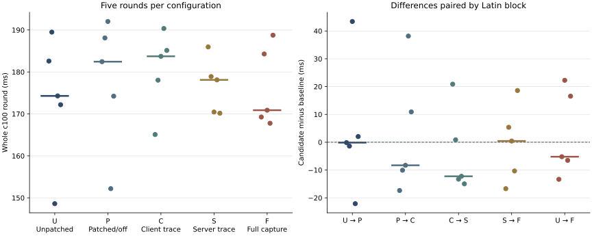

# EPYC 9654 机器：100 并发 profiler 开销对照与完整阶段瓶颈报告

日期：2026-10-29（北京时间）。 测试机：**EPYC 9654 机器**。本页为公开发布副本，统计值与本地归档一致；附件范围及脱敏说明见 [发布说明](PUBLICATION.md)。状态：**35 轮正式测试完成，3500/3500 请求成功；五轮完整 profiler 的 500 个正式请求和 15 个预热请求分别关联。** 额外 Go 运行时轨迹因另一会话构建、随后换版而未采集，具体等待根因的证据边界见下文。

## 结论与阅读入口

**之前缺失的 Client→API、API→Master 已在真实 100 并发下补齐；同时发现并补上了 Master 业务计时之前的模板解析。** 五轮模板解析的逐轮均值中位数为 34.408 ms，locality 检查为 20.902 ms，绑定副本为 8.217 ms。热模板缓存路径仍执行快照/副本数据库查询，这是本次最明确、此前被遗漏的优化方向。

**本批没有测出方向稳定的 profiler 整体开销。** 未打入口补丁的 U 与完整采集 F，整轮中位数为 174.288 / 170.883 ms（−1.954%），但均值为 173.434 / 176.190 ms（F 反而高 2.756 ms）。五个同 block 差值同时有正有负、范围显著重叠；不能称 profiler 提升性能，也不能据此保证零开销。

- [五轮全部 79 项阶段及覆盖](STAGES.md)；[395 行逐轮 CSV](data/stage-rounds.csv)；[逐阶段完整 JSON](data/stage-summary.json)。
- [35 轮对照明细与六类差值](COMPARISON.md)；[逐轮 CSV](data/rounds.csv)；[完整验收 manifest（本地留档）](PUBLICATION.md#unpublished)。
- [构建机 构建验证](evidence/BUILD-AND-ENVIRONMENT.zh-CN.md)、[EPYC 9654 机器 原生验证](evidence/provenance.json)、[源码与 SQL 证据](evidence/SOURCE-AUDIT.zh-CN.md)。

## 1. 如何区分 profiler 自身带来的差异

固定 c100 / n100 / create-only / 同进程 w3；U/P/C/S/F 各五轮，采用 UPCSF、PCSFU、CSFUP、SFUPC、FUPCS 的交错顺序，每组在每个顺序位置各出现一次。每轮重启 API/Master，至少等待 20 秒，再经过空库存、738 Ready TAP、无冲突工作与 load1≤4 门禁。没有清空页缓存、重建模板或修改探针。门禁重试会延长服务存活时间，因此不声称各轮缓存完全相同。

| 组 | 服务构建/开关 | 客户端 | 额外完整采集 | 回答的问题 |
| --- | --- | --- | --- | --- |
| U | 现场公共补丁栈，未打 frontdoor | SID/warmup 导出基础版 | 无 | 同源码工具链基线 |
| P | 编入 frontdoor，运行关闭 | 同 U | 无 | 补丁编入且关闭的差异 |
| C | 同 P，运行关闭 | HTTP trace 构建 | 无 | 客户端观测及请求头组合差异 |
| S | 同 P，运行开启 | 同 C | 无 | 服务端观测开启差异 |
| F | 同 P，运行开启 | 同 C | capture_100.sh | 完整采集流程附加差异 |

每组都有共同的负载前后身份与日志窗口记录；“无额外完整采集”不表示完全没有观测。基础客户端与 trace 客户端是不同构建，不冒称同一 binary 的 off/on。S/F 每轮 API、Master 各实测 103 条，ID 与客户端一致；U/P/C 未产生本轮服务端观测。

主指标为 `summary.total_time_s × 1000`，单位 ms，越低越好。它是正式 100 请求整轮完成时间，排除 w3；旧 `create_ms` 只到响应头，不覆盖全部 trace 初始化及响应体处理成本。统计单位为五个轮次，不能把一个并发批次的 100 请求当 100 次独立重复实验。

图中每点为一轮或同 block 差值，短横为中位数；没有把请求样本当实验轮次，也没有显著性/等效性保证。

| 组 | 按 block/执行顺序的五轮整轮耗时（ms） | 中位数 | 均值 | 范围 |
| --- | --- | ---: | ---: | --- |
| A_before | 145.169 / 145.633 / 146.708 / 144.602 / 154.986 | 145.633 | 147.420 | 144.602–154.986 |
| U | 182.596 / 189.490 / 148.609 / 174.288 / 172.188 | 174.288 | 173.434 | 148.609–189.490 |
| P | 182.449 / 188.108 / 192.025 / 152.193 / 174.227 | 182.449 | 177.800 | 152.193–192.025 |
| C | 165.087 / 178.038 / 183.727 / 190.351 / 185.130 | 183.727 | 180.467 | 165.087–190.351 |
| S | 185.962 / 178.901 / 170.449 / 178.109 / 170.166 | 178.109 | 176.717 | 170.166–185.962 |
| F | 169.261 / 184.282 / 170.883 / 167.775 / 188.753 | 170.883 | 176.190 | 167.775–188.753 |
| A_after | 198.207 / 140.987 / 137.388 / 138.754 / 149.596 | 140.987 | 152.986 | 137.388–198.207 |

A_before / A_after 使用原部署二进制与原客户端，各五轮。回测首轮 198.207 ms 原样保留；其余四轮 137.388–149.596 ms。中位数下降 3.190%，均值却升高，说明仅用一个统计量会误读漂移。A_before 是长时间运行服务，A_after 首轮刚恢复重启；客户端导出、编译工具链和旧二进制精确 tree 的证据层级也与 U 不同，**不能用 A→U/F 判断补丁成本**。

| 对照 | 组中位数差（ms） | 中位数变化 | 同 block 差值均值（ms） | 同 block 差值范围（ms） | 判断 |
| --- | ---: | ---: | ---: | --- | --- |
| U→P | +8.161 | +4.682% | +4.366 | -22.095～+43.415 | 范围重叠、配对方向不稳定 |
| P→C | +1.279 | +0.701% | +2.667 | -17.362～+38.159 | 范围重叠、配对方向不稳定 |
| C→S | -5.618 | -3.058% | -3.749 | -14.965～+20.875 | 范围重叠、配对方向不稳定 |
| S→F | -7.226 | -4.057% | -0.527 | -16.702～+18.587 | 范围重叠、配对方向不稳定 |
| U→F | -3.405 | -1.954% | +2.756 | -13.335～+22.273 | 范围重叠、配对方向不稳定 |

U→F 的五个配对差为 −13.335、−5.208、+22.273、−6.513、+16.565 ms；S→F 均值差仅 −0.527 ms，但配对范围 −16.702～+18.587 ms。**结论是当前五轮证据不足以给出稳定的 profiler 开销百分比，而不是把更低的中位数当作优化。** 原始快慢轮均未自动剔除。

## 2. 从客户端开始的完整入口分解

**阅读方式：先沿主链 1 → 10 看执行顺序，再展开第 4 段 Master。** 编号 `4.1` 属于 `4`，`4.1.1` 属于 `4.1`；缩进表示包含关系，不能将父阶段与子阶段重复相加。

统计口径保持不变：五轮各自计算正式 100 请求的均值/P95，再取轮间中位数；范围为五个轮均值的最小值与最大值，P95 用 nearest-rank。**本节所有计时行均覆盖 500/500 个正式请求**，预热单列。

### 2.1 请求主链：从上到下依次执行

总计行是整个请求的包络；下方 1–10 按同一请求的事件顺序排列，从请求开始一直列到结束。第 4 行耗时包含后面展开表的 Master 内部耗时。

| 顺序 / 层级 | 阶段 | 五轮均值中位（ms） | 轮均值范围（ms） | 五轮 P95 中位（ms） |
| --- | --- | ---: | --- | ---: |
| 总计 | **客户端完整请求：覆盖下方 1–10** | 130.466 | 127.695–144.324 | 162.626 |
| 1 | 客户端开始 → API 入口 | 5.054 | 4.508–5.629 | 10.490 |
| 2 | API 入口 → 派发 Master | 0.018 | 0.016–0.020 | 0.037 |
| 3 | API 派发 → Master HTTP 入口 | 8.246 | 7.516–16.635 | 20.803 |
| [**4 · 展开 ↓**](#master-breakdown) | **Master HTTP middleware 总体** | 117.561 | 105.931–130.571 | 149.254 |
| 5 | Master 边界 → API 接收解析完成 | 0.203 | 0.173–0.298 | 0.299 |
| 6 | API 收到 Master 后 → 响应准备完成 | 0.074 | 0.058–0.078 | 0.136 |
| 7 | API 响应准备 → 客户端收到响应头 | 0.156 | 0.136–0.238 | 0.226 |
| 8 | 客户端读取响应体 | 0.072 | 0.050–0.091 | 0.108 |
| 9 | 客户端解析响应体 | 0.010 | 0.007–0.015 | 0.021 |
| 10 | 客户端解析后收尾 → 请求完成 | 0.005 | 0.004–0.006 | 0.012 |

**主链用于说明事件顺序，不作数值严格加和。** 同进程偏移量与跨进程单调时钟来自分别采样的读数，因此单请求的分段合计也可能与总计存在采样差值。表中的中位数和 P95 又分别聚合，更不能相加核对总计；例如各段的“五轮均值中位”可能来自不同轮次。第 8–10 段取自已归档的同一批观测，补在这里展示请求结束边界，没有新增实验。

### 2.2 展开主链第 4 段：Master 内部的包含关系

**执行顺序：4.1 模板解析 → 4.2 创建业务。** 模板解析内部按 4.1.1 → 4.1.2 → 4.1.3 → 4.1.4 执行。`R` 是这些已测区间之外的外围余量，可能分布在前后或间隙，**不代表最后才执行的一个步骤**。

| 顺序 / 层级 | 阶段 | 五轮均值中位（ms） | 轮均值范围（ms） | 五轮 P95 中位（ms） |
| --- | --- | ---: | --- | ---: |
| **4** | **Master 总体（父阶段，与主链第 4 行相同）** | 117.561 | 105.931–130.571 | 149.254 |
| ↳ **4.1** | **业务前模板解析（先执行）** | 34.408 | 26.821–42.242 | 49.539 |
| 　↳ 4.1.1 | 模板 request 准备 | 2.985 | 2.310–4.510 | 12.299 |
| 　↳ 4.1.2 | 模板 locality 检查 | 20.902 | 15.462–25.571 | 35.903 |
| 　↳ 4.1.3 | 模板 kind 判定 | 0.000 | 0.000–0.001 | 0.001 |
| 　↳ 4.1.4 | 绑定 ready replica | 8.217 | 7.706–11.462 | 21.919 |
| ↳ **4.2** | **Master 业务 cube-e2e（模板解析之后）** | 80.738 | 77.129–84.899 | 103.941 |

> **旁注 · 外围余量 R（位置未细分）**：五轮均值中位 **1.981 ms**，轮均值范围 1.531–3.927 ms，五轮 P95 中位 12.432 ms。它是同请求 `4 − 4.1 − 4.2` 的差值，分散于已测阶段之外，不放入执行顺序。

- **`4 = 4.1 + 4.2 + R`**：这个关系在同请求原始计时上成立；各行聚合后的中位数/P95 仍不能直接相加。
- **`4.1` 包含 `4.1.1–4.1.4`**：子阶段之间还有日志、外围执行等未独立列出的区间，四个子项不等于完整模板解析。kind 显示 0.000 ms 是三位小数舍入，不表示严格为零。
- **`4.2` 的更细分解见第 3 节**：Cubelet、VM、agent 与探针属于创建业务的进一步观测，不能再加到主链第 4 行之外；Host 日志轴与这里的单调时钟轴保持分开。

500 个正式请求均有唯一 SID 和 Master RequestId 关联。Client/API 外层单调时钟链、API/Master 子链和 Host 日志链在五轮中分别全部 100/100 完整；未出现负时序或负残差。跨进程单调时钟相减先验证同一 Linux boot、time namespace 与 clock kind；旧 Host RFC3339 日志保持独立轴。原远端 frontdoor 与本地复算逐请求一致。

**模板解析原本为什么不见了？** 它发生在分配 SID、启动 `cube-e2e` 之前，日志 `InstanceId` 为空。旧工具按 SID 筛选会漏掉；现在只通过已验证的双向唯一 RequestId↔SID 关联，冲突、重复、未知归属不推断。每请求扣除模板和业务后的 Master 外围残差均值中位仅 1.981 ms，原来 HTTP 总体与业务计时之间的主要缺口已解释。

**API→Master 的 8.246 ms 不是“纯网络延迟”。** 起点早于 URL/JSON 构造，终点是 Master 已分派到 middleware；它包含同步构造、reqwest 连接/发送、Tokio 调度、内核网络及 Master 接收调度。目前没有这些子步骤的独立计时，不能进一步归到某个内核/TCP原因。

## 3. Master 内部到 VM 与探针的阶段

以下是同 SID 的 Host 日志区间或组件自身 duration；不与上一表叠加。[完整 79 项表](STAGES.md)列出各项指标、稀疏覆盖与缺失状态；[匿名逐请求 JSON](data/requests.json)可筛选每轮最慢请求并查看同请求各阶段数值，原完整逐请求分析报告仅在本地留档。79 项不代表所有底层操作都已测到：原 profiler 的 23 个 network-details 字段另提供[五轮安全投影](data/network-details.json)，数据稀疏，不能据此进一步认定 TAP/路由内部瓶颈。

| 阶段 | 覆盖 | 五轮均值中位（ms） | 轮均值范围（ms） | 五轮 P95 中位（ms） |
| --- | --- | ---: | --- | ---: |
| Master 业务开始→Cubelet 收到请求 | 500/500 | 13.367 | 10.918–17.719 | 27.180 |
| Cubelet 早期准备→resolved | 500/500 | 17.296 | 13.743–19.969 | 41.269 |
| resolved→Shim 开始 | 500/500 | 6.527 | 6.436–6.749 | 7.739 |
| Shim snapshot init→cgroup join 标记 | 500/500 | 0.615 | 0.226–1.369 | 3.424 |
| VM start→agent ready（包含 ResetVm） | 500/500 | 16.463 | 16.119–16.843 | 19.063 |
| agent ready→Shim 完成 | 500/500 | 6.103 | 5.983–6.187 | 7.518 |
| Shim 完成→Master 业务回包 | 500/500 | 19.628 | 19.265–19.982 | 25.097 |
| 就绪探针（嵌套指标） | 500/500 | 14.873 | 14.650–15.139 | 17.226 |
| storage（仅记录到的长阶段） | 365/500 | 19.658 | 17.831–21.356 | 39.123 |

storage 各轮覆盖 61/74/80/81/69，仅 365/500；Cubelet 的成功阶段 <5 ms 可能不输出，故该均值有选择偏差，不能代表所有请求。cgroup stat 仅 22/500，network / metadata / store stat 均缺失，不补零。snapshot_init→cgroup_join 的完整日志区间是 500/500，但也不等于单个 cgroup syscall。

可见成本分布在多个位置：模板预处理、Master 派发、Cubelet 早期准备、VM/agent 恢复和收尾探针。cgroup join 区间总体较小，不支持将它当作本批主瓶颈。探针约 14.9 ms，五轮稳定；本批没有历史 resume c10 的约 500 ms 重试台阶。ResetVm 已包含在 VM→agent 内，不能再次相加。

## 4. 已证实的瓶颈机制与仍缺的证据

**优先处理模板热路径中重复的数据库往返。** 固定源码显示普通 app-template 即使 templatecachehit，也依次进行：

1. `skipTemplateLocalityReady → GetSnapshotRestoreSource → getSnapshotRecord` 查询 snapshot 表；普通模板通常得到预期 not-found。
2. `EnsureTemplateLocalityReady → isTemplateReplicaSchedulable` 查询模板/节点副本，之后才记录 localityhit。
3. `bindAppSnapshotTemplateReplica → ResolveTemplateReadyReplica → ListReplicas` 再次查询副本并选择 ready 节点。

100% definition-cache hit 与 locality-hit 不代表这些查询被省略。运行配置为 MySQL、max_open_conns=20、max_idle_conns=5；源码将它们设置到共享 `sql.DB`。这使连接池等待成为优先假设，**但尚没有实际 DBStats/trace 的等待时长，不把配置上限当作实测队列占用**。

已有 journal 的窄窗口还确认 105 次 snapshot not-found 查询：SQL-call elapsed 均值 6.339、P95 14.960、最大 29.837 ms。该 elapsed 在 GORM 自身日志格式化/打印之前取得，所以已有毫秒长尾不能全部解释成该条日志写入；但它包含 ORM/连接池/网络/DB 调用，仍不是纯 DB 服务端执行时间。105 条缺少 RequestId，不能按顺序伪装成正式 100，也不能直接与正式阶段均值相减。完整源码行号和安全提取结果见[源码审计](evidence/SOURCE-AUDIT.zh-CN.md)。

CubeLog metric 为同步日志路径，GORM 在默认 Warn 阈值下仍会为预期 snapshot miss 输出错误日志；这些日志可能产生额外调度或锁成本。现有证据确认“查询与日志确实发生、模板阶段确实耗时”，尚不能把 34.4 ms 全归因于 SQL 池、日志锁或 CPU。

下一步修改应先减少不必要的 snapshot 类型探测、考虑在同一请求内复用已校验的 replica 结果，并保留失效/一致性语义；再用 SQL-call、池等待、日志提交的独立计时验证。不要仅凭 100 并发就直接把连接池从 20 调到 100，也不要把整个模板阶段当作预计可节省的时间。本次未实现或验证这些性能优化。

### 额外运行时轨迹为何未交付

35 轮结束后，单独的 Go trace 诊断在部署前被门禁发现外部 cargo/rustc 进程而退出，未启动负载、未启用调试端口、未替换服务。随后只读回读发现另一会话已在 13:08:47–48 部署新的 API/Master，源码与运行服务均已更新。因此没有覆盖对方部署来继续旧基线诊断。

本次 A_after-r5 在 13:06:05 完成，13:06:22 收尾门禁仍通过，API/Master 为本任务恢复的原 SHA。新部署发生在全部计时与验收之后，未混入 35 轮。**“本任务已恢复并完成回测”是已证实的历史状态；不能写成现在仍运行原二进制。** [后续外部变更回读（本地留档）](PUBLICATION.md#unpublished)与[未采轨迹记录](RUNTIME-TRACE-STATUS.md)单独保留。

## 5. 构建、补丁与实际运行身份

构建机 使用隔离源码和相同工具链构建 U/P；Rust 1.89、Go 1.25.7，API glibc 最高引用 2.29。构建验证与 EPYC 9654 机器 原生入口检查均通过；详见[构建报告](evidence/BUILD-AND-ENVIRONMENT.zh-CN.md)与[完整产物 SHA](evidence/provenance.json)。没有更换内核或 Cubelet。

| 层次 | 固定身份 |
| --- | --- |
| CubeSandbox 公共基点 | https://gitcode.com/boostkit/CubeSandbox；`2babb6f7405677c04b7fed1563c6a5d53a8e771b`，tree `608397465872e2050e823fd4ebf1207d3d1208f0` |
| 公共现场修改 | CloneSandboxInfo、API get_info cache/skip、Master READY pause 绑定早返回三文件；[完整补丁（本地留档）](PUBLICATION.md#unpublished)，SHA `d10d4366db67aaeb0acfae63fe16058152ba829cd5dff25b8e5aae7cc3192c13`；U/P均编入，无运行开关 |
| U 最终源码快照 | commit `9ddc0a6f4501d72c155bfbb4f0b1a7054b06aeb0`，tree `285f21316b8fbbe1b402a50ae94d660e4582c414` |
| P 新增入口观测补丁 | SHA `c24254fc66a1d1e3d1536f0029d64eb8dd07bb475a6369a861860ddf58683eeb`；接在公共修改之后 |
| P 最终源码快照 | commit `747e5c1b71d992f780df4a1e7aa12b5bfa82b96a`，tree `a679b91d35a1a3cc317c21f0dbd566397dc8b446` |
| 客户端源码基点 | 社区 `31d911e430fdf8a8879bd062b8e78066c1a8e89d`；基础版补 SID/warmup 导出，trace版再补 HTTP 观测，均无同 binary 运行开关 |
| 采集工具 | `f1f6b0156d7b0c53094326f04527bb45aaeca382` |
| 离线补正工具 | `054e931ee1fe0ef63ae0a09f39fce534897a4111`，tree `7b90cd7fcbe3532b6c913d4ab5737d1ba5e17c67`；395项测试全过，无skip，远端main回读一致 |

服务端开关 `CUBE_FRONTDOOR_TRACE`：U无此补丁；P/C编入并显式0；S/F编入并显式1。实际进程 `/proc/<pid>/exe` SHA、环境与三端事件覆盖共同验收，不能仅看配置值。

| 实际二进制 | U SHA256 | P SHA256 |
| --- | --- | --- |
| api | `d17fb1700509b2e590f997e0270590c29cfc74df42eea5a1df07262d87608f47` | `6d1b92f96b6f3daa06a4a04c3fd4473d884dcfc3d697f0e080f57f098c610f9b` |
| master | `f3f0fd3afe2618c2ba01af5ac39d9249020db77daefdb8887eddbaf2235c7da3` | `be2c5163a602503723534ab30cad2f2f12cd6e49c4df27d0f74f434b073d37ea` |

其余固定条件：内核 6.6.0、THP madvise、NUMA balancing=0、738 Ready TAP；模板 A（2000m/2048Mi，1G writable，XFS，49999 `/health`）。Cubelet `506b8a83…`、实际组件版本目录 Shim `2153cb46…` / runtime `c8875540…` 在所有轮前后保持一致。逐轮完整 SHA、配置 SHA、源码 observed diff 与条件见[验收 manifest（本地留档）](PUBLICATION.md#unpublished)。内核源码 commit 未在本任务核实，不据版本字符串推断它包含哪些补丁。

A 锚点原 API `51542159…`、Master `cce1af82…` 的精确编入 dirty tree 没有原始构建清单，因此只作漂移锚点；统一工具链的 U/P 有完整源码与构建链。这项差别没有隐去。

## 6. 证据完整性、预热与复现

- 五轮 F 核心三条链各500/500，预热15条另列；旧报告缺入口的历史数据未回填或冒充新采集。
- 每轮八份 profiler日志的 SHA 已核验：七份原字节一致，一份含凭据的 Cubelet 日志通过[原始日志脱敏记录（本地留档）](PUBLICATION.md#unpublished)保留远端原 SHA 与本地 SHA 桥接。原 manifest 未篡改成脱敏后的字节。
- F1清理文件重名、S4日志轮转补验、后段load等待均保留[执行记录](EXECUTION-NOTES.md)，成功计时未替换。负载窗口外检查与其他会话干扰边界仍保留，门禁不证明宿主绝对无后台活动。
- 本次 w3 是同进程三次串行创建，它不保证预建100条连接或充分填满SQL池。F1客户端正式请求实测99条新连接、1条复用；API→Master连接复用没有直接观测，不能类推。服务缓存与连接池热度、创建请求并发度仍影响延时。
- 这里的 w3 不等于前一份 resume 报告里的快照文件预读：后者改变内存文件驻留，预读成本需单列；不能将其收益套用到本次 create-c100。

通用工具新增修复已[推送远程仓库 main](https://gitcode.com/yuncongyue/cubesandbox-startup-profiler)，[发布身份与测试](evidence/profiler-publication.json)可核验。本报告与可复算的公开数据归档在 materials；原始服务日志、完整配置、源码 bundle 与部署脚本仅在本地保留。详见 [数据说明](data/README.zh-CN.md) 和 [公开范围](PUBLICATION.md)。
