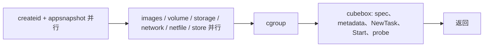

# CubeSandbox v0.7.1：c100n100 更细阶段时延分析

本报告补解析了 **同一轮真实 c100n100** 的网络子阶段，并交付默认关闭的 Cubelet / Shim 精细观测补丁、解析器和独立时钟时间轴查看器。原版正式100次仍为全部成功，客户端平均 **368.590 ms**、P95 **491.460 ms**。

**新增实测结论**：有记录的77次网络创建中，端口规则下发平均 **30.003 ms**、TAP注册外层 **14.589 ms**；51次TAP FD handoff中，`dup_fd`区间平均 **5.103 ms**，而快照仅 **26.649 µs**。微秒计时已能读出，但这些是部分样本，不能声称是全部100次分布。

**重测状态：尚未执行。** 观测版已在90机器编译和单测通过。准备部署期间，90出现另一项density测试，最初384个、15:30:51Z核验时768个非本任务沙箱，因此未替换任何运行二进制、未重启Cubelet、未清理这些沙箱。观测版100次完整覆盖和开销对照尚无实测结果；本报告没有以模拟数据补齐。相关源码、构建摘要和待执行步骤已备齐。[部署状态与官方二进制摘要核验](deployment-status.json)。

## 1. 测量对象与证据

沿用[原版完整报告](../v071-c100n100-20261012/REPORT.md)及其[构建来源](../v071-c100n100-20261012/template-build-provenance.json)：

- 源码基线：`v0.7.1 / 31d911e430fdf8a8879bd062b8e78066c1a8e89d`，ARM64 90机器。
- 模板：`tpl-cf2b04fdd4604b7c84e157fa`，sandbox-code镜像digest `sha256:e1cb43e12ba70b8453b45f0c063306faab8a6974aa3fd76982dc4d019d07c60d`，2 vCPU / 2048 MiB / 1G可写层，READY本地副本。
- 官方cube-bench：`-c 100 -n 100 -w 3 -m create-only --no-tui`。统计不混入3次预热和1次独立功能预检。
- 实际采集窗口：90机器 UTC `2026-10-12T14:14:45.578277Z`～`14:15:56.155873Z`；正式批次496.329 ms。控制机与90时钟不混减。
- 本次补解析重新验证归属、原始文件SHA256、Master完整请求/响应、串行预热边界和稳定进程身份，未重新跑旧样本、未修改其归属文件。
- 网络源文件742,819 bytes，SHA256 `26dec4af14aaa4f682535cac44b60c28afc0edb258fa9e2afffe0ad3734bf2e2`。共260条计时日志（正式与预热合计），无非法外层JSON、ID冲突、重复操作或时间窗越界。正式阶段按100个Sandbox ID独立筛选。

所有网络表格数字单位为 **µs**，1,000 µs = 1 ms。P50/P95采用nearest-rank。Go原始duration保留ns/µs单位，只表示记录分辨率；它不意味着纳秒级真实测量准确度，也不是CPU执行时间。

## 2. 网络子阶段完整明细

| 源码计时字段 | 覆盖 | Avg µs | P50 µs | P95 µs | Max µs |
| --- | ---: | ---: | ---: | ---: | ---: |
| `create_stages.total` | 77/100 | 48228.786 | 39910.680 | 115696.430 | 137802.610 |
| `create_stages.ensure_route` | 77/100 | 0.760 | 0.770 | 1.230 | 1.320 |
| `create_stages.acquire_tap` | 77/100 | 7.008 | 6.660 | 10.860 | 12.930 |
| `create_stages.reserve_ports` | 77/100 | 57.134 | 5.230 | 411.480 | 1067.710 |
| `create_stages.write_tmp` | 77/100 | 3479.966 | 3164.380 | 6878.910 | 7031.230 |
| `create_stages.commit_creating` | 77/100 | 46.915 | 21.640 | 232.070 | 457.380 |
| `create_stages.apply_port_mappings` | 77/100 | 30002.956 | 28905.470 | 54317.920 | 60883.200 |
| `create_stages.register_cubevs_tap` | 77/100 | 14588.772 | 7838.480 | 59549.110 | 73792.140 |
| `create_stages.push_egress` | 77/100 | 0.531 | 0.480 | 0.940 | 1.250 |
| `create_stages.commit_success` | 77/100 | 41.342 | 24.710 | 56.910 | 642.840 |
| `create_stages.commit_active` | 77/100 | 1.973 | 1.830 | 3.030 | 7.180 |
| `ensure_precheck.total` | 77/100 | 52204.041 | 41042.800 | 120951.130 | 138447.810 |
| `ensure_precheck.lock_wait` | 77/100 | 6.692 | 1.910 | 4.300 | 228.290 |
| `ensure_precheck.inmem_lookup` | 77/100 | 9.837 | 10.210 | 19.800 | 27.790 |
| `ensure_precheck.exists_check` | 77/100 | 24.134 | 23.810 | 34.010 | 38.570 |
| `ensure_precheck.legacy_check` | 77/100 | 3239.291 | 2699.350 | 6089.710 | 6540.410 |
| `ensure_precheck.create_state` | 77/100 | 48723.482 | 39974.940 | 115741.490 | 137858.310 |
| `register_cubevs_tap.total` | 55/100 | 18948.002 | 9657.610 | 63070.740 | 71384.780 |
| `tap_fd_handoff.total` | 51/100 | 5138.032 | 3729.770 | 12509.100 | 23446.650 |
| `tap_fd_handoff.lock_wait` | 51/100 | 5.680 | 2.410 | 6.310 | 161.940 |
| `tap_fd_handoff.snapshot` | 51/100 | 26.649 | 26.250 | 35.400 | 44.540 |
| `tap_fd_handoff.open_tap` | 51/100 | 0.031 | 0.030 | 0.040 | 0.070 |
| `tap_fd_handoff.dup_fd` | 51/100 | 5103.230 | 3696.100 | 12474.870 | 23411.480 |

[可复算JSON及逐实例字段](network-details.json) · [CSV](network-details.csv)。这些阶段嵌套，不得把全表相加。

### 2.1 网络创建路径主要耗时在哪里

`create_stages.total`在同一77个可观测实例中平均48.229 ms，其中：

- `apply_port_mappings`：平均30.003 ms，占上述总时长均值约62.2%；应优先细分规则准备、操作下发、等待及锁等内部区间。
- `register_cubevs_tap`：平均14.589 ms，约30.2%。它包含配置转换、日志和AddTAPDevice；独立`register_cubevs_tap.total`只包AddTAPDevice，且仅55条。不能把55条的18.948 ms与77条的14.589 ms直接相减来推导额外开销。
- `write_tmp`：平均3.480 ms。相较于`acquire_tap`的7.008 µs、`reserve_ports`的57.134 µs，更值得调查文件路径与状态落盘。
- `ensure_precheck.legacy_check`：平均3.239 ms；`ensure_precheck.create_state`包含整个create path，因此ensure与create两行不能累计。

这些给出了下一步观测优先级，尚不能证明瓶颈因果是内核、锁或磁盘。函数区间的elapsed包含阻塞、抢占、调度等待和函数内部日志。

### 2.2 TAP FD handoff

51个可观测实例的handoff平均5.138 ms，其中`dup_fd`平均5.103 ms，而`snapshot`仅26.649 µs。这支持优先检查FD复制路径的等待/调度，不支持仅凭该字段认定一个dup系统调用消耗5 ms的CPU。

`open_tap`平均0.031 µs只是已有FD分支的计时开销；命中缓存时并不真的open TAP。handoff最多两次尝试，snapshot/open/dup字段会跨attempt累计。

### 2.3 为什么仍不是100%覆盖

原版四类网络日志分别在“本操作total ≥1ms或失败”时输出；子阶段即便只有几十ns，也能随父记录保留。正式create/ensure各77条、register55条、handoff51条。

缺失23/45/49条不能补0，也不能全部当作低于门槛：源码分支、日志过滤/投递缺失等也会造成不可见。已记录create最小约12.396 ms，不能据此证明其余23次都小于1 ms。采集文件无缺口只证明文件增量完整，不证明应用输出了每个事件。

网络duration字段0按`unknown_execution`处理：某些失败步骤会在赋duration前返回，0既可能未执行，也可能执行失败后未记时。显式精细span记录的0时长则有起止证据，两者在新解析器中分开处理。

## 3. 放回整体启动链路

原版同一轮的主要阶段为：

| 阶段 | 覆盖 | Avg ms | P95 ms | 解释 |
| --- | ---: | ---: | ---: | --- |
| 客户端HTTP Create | 100/100 | 368.590 | 491.460 | 到client.Do返回，通常收到响应头 |
| Cubelet service | 100/100 | 322.485 | 407.236 | 源码service既有计时窗口 |
| cubebox外的service工作 | 100/100 | 98.413 | 153.397 | 同实例相减的非连续残差 |
| cgroup | 92/100 | 60.149 | 99.312 | 原版有门槛的可见子集 |
| network | 77/100 | 52.792 | 121.139 | 与storage等同step并行 |
| sandbox-create / NewTask | 100/100 | 154.272 | 209.193 | Cubelet外层累计区间 |
| Shim CreatePodSandbox | 100/100 | 77.540 | 107.000 | 包含VM恢复和Agent RPC等 |
| RestoreVm | 100/100 | 18.260 | 46.000 | Shim原版整数ms |
| ResetVm | 100/100 | 19.590 | 28.000 | Agent reset RPC等 |
| CreateContainer | 100/100 | 19.880 | 38.000 | Template snapshot-restore分支 |
| readiness probe | 100/100 | 40.923 | 62.092 | cubebox后续就绪探测 |

真实workflow并行关系：



网络细分没有改变整体判断：前置workflow、NewTask窗口和probe均有值得解释的耗时。不能把network + storage相加，也不能把VM restore单点认定为总启动时延的全部原因。NewTask和Shim跨进程窗口不同，差值仍不能直接命名为“Shim启动”实测时延。所有P95均各自统计，不做P95相减。

## 4. 已实现的精细观测版

[源码补丁](../../scripts_v071/observation.patch)可直接应用于v0.7.1，默认`CUBE_PERF_TRACE`未设或不为`1`时关闭。源码补丁SHA256：`864e4de012cce70050d7033788a387aeec7030774564ee1f779f86646b267d26`。

| 观测位置 | 新增能力 | 准确性边界 |
| --- | --- | --- |
| Cubelet request | 每请求一个批次，sandbox/request ID、root span | 起点沿用旧service，位于checkParam之后，不是整个gRPC入口 |
| workflow group/action | 真正单调起止、span/parent ID | 展示并行和重复调用；同名不同kind独立统计 |
| dispatch / limiter | 提交goroutine到开始执行、限流等待区间 | elapsed包含调度影响，不等同CPU时间 |
| 既有叶节点metric | 保留微秒浮点duration，绕过短阶段门槛 | 标`duration_backfill`，不把记录时刻回推当精确起点 |
| network四类日志 | 开启时绕过1ms父日志门槛 | 实际是否100%仍由覆盖率验收，0累加器不补值 |
| Shim StatDefer | 保留CostTime(ms)，加DurationNs/Us、单调起止、ClockId/OperationId | 同进程同clock才比较，原版ms字段兼容 |
| Shim TaskCreate | 7个同operation累计检查点 | 相邻差分为真实边界间区间，含区间内日志和观测成本 |
| Shim队列 | surviving event携带之前丢记录计数 | 不能证明尾部无丢失或磁盘写入无失败 |

累计点顺序为`LoadSpec → AcquireSandboxLock → CheckSandboxState → InitSandbox → StartSandbox → CreateContainer → PublishTaskEvent`。例如LoadSpec到AcquireSandboxLock还包含二者间日志，不能将差值命名为纯锁等待。缺点/重复/顺序异常时解析器拒绝细分，跨过的检查点明确列出。

Cubelet一批次在request结束冻结后异步输出，日志时间不是阶段终点；真实interval与回填duration独立呈现。Cubelet与Shim各自画图，各自使用时钟，不做跨进程伪精确对齐。Nanosecond格式只提高表示精度，不消除观测成本。

仍未新增Guest内部passfd、日志恢复、锁、exec细分，也未修改Master埋点。Guest在Template内是snapshot状态，若要改Guest观测，需要重建包含新Agent的模板并单独标识版本；不能仅换宿主机二进制后宣称测到了Guest内部细节。

## 5. 构建与验证

- 90原生ARM64构建，Go1.25.7、Rust1.77.2；Rust采用`cargo build --release --locked -p containerd-shim-cube-rs`，CGO保持开启。
- Cubelet perftrace、workflow、network/runtime、cubebox相关测试通过；开启开关的短metric专项测试通过。本地collector的race测试在开/关环境通过。
- Shim日志相关6项测试通过；release构建通过。补丁在干净v0.7.1上`git apply --check`通过，并与15个工作区文件一致。
- 复用cubecow静态库和BPF生成对象之前，逐项比对相关75个源码/头文件/依赖定义，全部与v0.7.1一致；8个复用产物有hash。[依赖来源核验](build-dependency-source-match.json)。这证明相关源码兼容，不等于可复现构建证明。
- [关闭模式构建清单](observation-off.json)、[开启模式构建清单](observation-on.json)显式标识`v0.7.1+perftrace`，不冒充原版发布二进制。开启/关闭使用同一套二进制，才能隔离开关影响。
- 新增network、precision解析测试涵盖ns单位、精度、ID/时间窗、重复/缺失、0语义、同名action与metric、多批次及累计差分。观测版验真另验证patch/hash/mode稳定性。合计101项Node测试、27项Python测试通过。[验证摘要](validation.json)；[14个实际编译源码逐文件匹配](compiled-source-match.json)。

## 6. 待执行的对照与验收

构建目录：90机器 `/data/cubelet/perf-evidence/fine-v071-20261012`；当前仅有source、构建产物、日志、清单，不代表已部署或已运行。

下一次独占窗口按以下顺序执行：

1. 确认外部density任务已结束，而不仅是两轮之间暂时没有沙箱；通过原suite静默门禁。
2. 备份官方Cubelet、全局Shim、**版本仓库的v0.7.1 Shim**及Cubelet配置，记录hash。Template会优先使用版本仓库的组件，仅替换全局路径无效。
3. 部署观测版，服务环境设开关；以实际运行Shim的`/proc/<pid>/exe`摘要及`environ`核验Template实际用到该版本。工具同时校验两处Shim文件。
4. 同一Template、相同官方bench与门禁，交错执行off/on，建议3对，各轮100正式+3预热；每轮独立capture，全部保留。先验证开关数据覆盖，再评估时延分布；不要把开关差异与重编译差异混在一起。
5. 每轮核验100成功、0错误，正式100个唯一Cubelet批次/root、预期Shim阶段覆盖、重复/异常/drop及清理账本。覆盖不足时查日志链路，不补0。
6. 以轮为单位报告API及阶段Avg/P50/P95、波动范围，单列观测开销。样本不足时不宣称开销可忽略；不可用总体P95相减定位子阶段。
7. 恢复官方二进制、移除本任务drop-in、核验配置和hash、确认服务健康及本任务实例清零。补充真正的observed-run数据和结论。

## 7. 工具复现

在包含完整私有证据的原capture上补解析：

```bash
node network_details.mjs CAPTURE --phase-classification CAPTURE/phase-classification.json
```

新观测capture的处理：

```bash
node classify_phases.mjs CAPTURE
node analyze.mjs CAPTURE --phase-classification CAPTURE/phase-classification.json > CAPTURE/analysis.json
node network_details.mjs CAPTURE --phase-classification CAPTURE/phase-classification.json
node precision.mjs CAPTURE --phase-classification CAPTURE/phase-classification.json
node precision_timeline.mjs CAPTURE/precision.json
```

`run_verified.py --observation-manifest observation-on.json`或`observation-off.json`可核验显式构建清单；它不自动部署，也不会在现有沙箱非空时继续。工具统一在[ scripts_v071 ](../../scripts_v071/README.md)。`precision.json/csv`保存ns统计、逐实例区间、kind/clock、完整覆盖及异常；`precision-timeline.html`离线打开，回填duration仅列表。

公开仓库保留派生数据、版本与hash，不公开含token/env的原始请求日志。完整旧capture仍保存在原报告所列90目录和本地工作区。本补充不改写原版基线结论。
